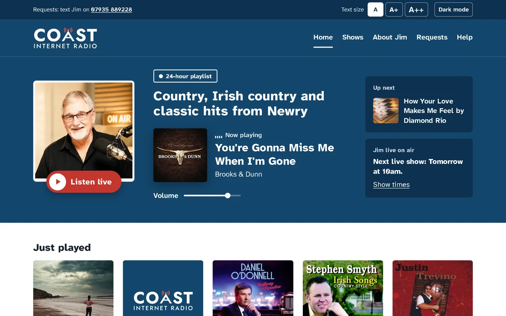
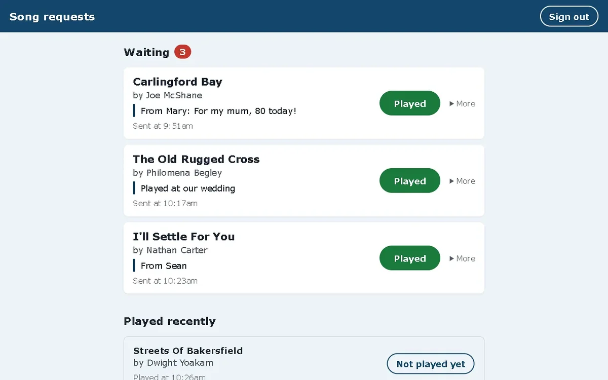
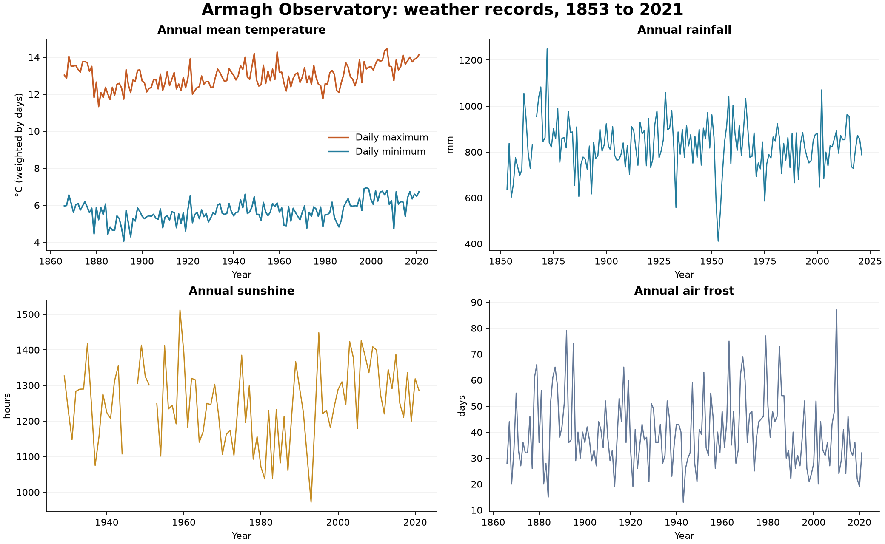

<picture>
  <source media="(prefers-color-scheme: dark)" srcset="header/murmuration-dark.webp">
  
</picture>

Second-year Computing Technologies student at Ulster University in Belfast, looking for a 12-month placement in software, web development or IT from summer 2027.

**Portfolio:** [jamieparr.dev](https://jamieparr.dev) · [jamieparr205@gmail.com](mailto:jamieparr205@gmail.com) · [LinkedIn](https://www.linkedin.com/in/jamie-parr-tech) · [CV](https://jamieparr.dev/uploads/Jamie-Parr-CV.pdf)

## Projects

<table>
<tr>
<td width="50%" valign="top">
 
<b><a href="https://coastinternetradio.com">Coast Internet Radio</a></b> 
Website for a radio station in Newry: live player, now playing with album covers, and an editor so the presenter updates the site himself. JavaScript, nine Netlify Functions, Cloudflare Workers. Live since October 2026. <a href="https://github.com/JamieP-205/coast-radio">Code</a> · <a href="https://jamieparr.dev/projects/coast-internet-radio/">case study</a>
</td>
<td width="50%" valign="top">
 
<b><a href="https://github.com/JamieP-205/coast-requests">Coast Requests</a></b> 
Song requests from the Coast website, collected into one list the presenter works through on air. Python, Flask, SQLAlchemy; 23 pytest tests run on every push. <a href="https://jamieparr.dev/projects/coast-internet-radio/">Case study</a>
</td>
</tr>
<tr>
<td width="50%" valign="top">
 
<b><a href="https://github.com/JamieP-205/eos-delivery-system">EOS Delivery System</a></b> 
C# Windows Forms coursework app for delivery quotes and invoices. Includes input validation, discounts, invoice export and print preview, with 24 automated checks. <a href="https://github.com/JamieP-205/eos-delivery-system/releases/latest">Download the Windows app</a> · <a href="https://jamieparr.dev/projects/eos-delivery-system/">Case study</a>
</td>
<td width="50%" valign="top">
 
<b><a href="https://github.com/JamieP-205/armagh-weather-analysis">Armagh Weather Analysis</a></b> 
Excel and Python analysis of 2,028 monthly weather records. Charts and CSV downloads, with checks for missing readings and incomplete years. <a href="https://jamiep-205.github.io/armagh-weather-analysis/">View the report</a> · <a href="https://jamieparr.dev/projects/armagh-weather-analysis/">Case study</a>
</td>
</tr>
</table>

## Currently

Studying Java this semester, and working on an Agile project in a team of five.

I'm also preparing **[NexusDesk](https://jamieparr.dev/projects/nexusdesk/)** for a public release: a Java and Spring Boot helpdesk with support tickets, equipment records and staff accounts. It's a personal practice project based on a brief I wrote. The code is still private while the next version is being checked; the portfolio has a preview of the existing demo.

## Skills

HTML, CSS, JavaScript, Node.js, Python, C#, SQL, Flask, SQLAlchemy, Excel, Git and GitHub, Netlify, Cloudflare Workers and Playwright.

---

The header is a flocking simulation of the starlings, written in WebGL and rendered to WebP so it can live in a README. The source is in [`header/`](header/).
